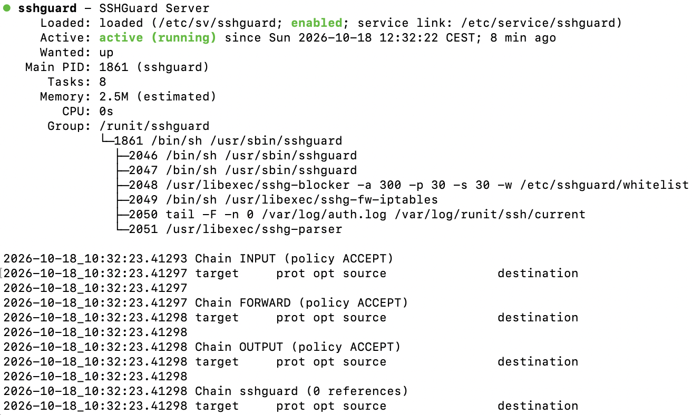

# wuw

`wuw` means “what’s up with”. It gives a compact, systemd-style status view
for a service managed by runit or a traditional SysV init script, without
requiring systemd.



It reports the service definition, enabled and active state, main process,
descendant processes, resource use, and recent logs when they are readable.
Runit services and their dedicated loggers are discovered under the usual
[Devuan](https://www.devuan.org/) paths. If no runit service is available,
`wuw` falls back to `/etc/init.d/SERVICE status`.

On a host booted with systemd, `wuw SERVICE` runs `systemctl status` and
`wuw SERVICE l` opens the last 10000 lines of its journal with `journalctl -e`
(`-n` sets another count), unless the service is enabled in runit (for example
with `runit-systemd`). Shell completion also offers systemd service names.

Complete status inspection requires root privileges. When an existing service
is requested by another user, `wuw` automatically re-executes its absolute
path through `sudo`. Log browsing uses the same automatic elevation.
Service listing and shell completion remain unprivileged
and never invoke `sudo`.

## Mirors

Public Git mirrors of my Mercurial repo:

- [wuw on GitLab](https://gitlab.com/uxmaster/wuw)
- [wuw on GitHub](https://github.com/uxmaster/wuw)

## Installation

On a machine configured to use the Enabla Devuan repository:

```sh
sudo apt update
sudo apt install wuw
```

## Usage

```text
wuw [-n lines] SERVICE [l]
wuw --list-services
```

Examples:

```sh
wuw ssh
wuw mysql
wuw -n 30 sshguard
wuw mysql l
```

Service names are completed dynamically in Bash, Zsh, and Fish from available
runit service directories and executable SysV init scripts. Bash users need
the suggested `bash-completion` package.

Append `l` to browse the service log in `less` instead of printing status.
The viewer starts at the end of the current log. For svlogd logs, completed
rotations (`@*.s`) are also available in chronological order: type `:p` for
an older file and `:n` for a newer one. Scrolling stays within the selected
file.
Press `Shift+F` to watch new entries, `Ctrl+C` to stop watching, and `q` to
quit. Following `current` reopens it when the logger rotates it.

Files are opened directly, without concatenating the history or counting
all its lines. Log browsing requires a readable per-service log; shared
syslog files are not scanned. Logs are displayed as stored, without timestamp
conversion. The pager runs in secure mode, disabling shell/editor commands
and input preprocessors.

`-n` sets the status excerpt (default 12); on systemd it also sets the journal
lines for `l` (default 10000).
Set `WUW_COLOR=always` or `WUW_COLOR=never` to
override automatic terminal colour detection. The standard `NO_COLOR`
environment variable is also honoured.

Runit status separates the current state (`Active`) from the requested state
(`Wanted`). A red blinking dot means the service is down and wants to start;
a green blinking dot means it is stopping or restarting. Only the dot blinks,
and the state is also written in plain text. Terminal support for ANSI blink
is required to see the animation.

An intentionally stopped service has a steady grey dot, including a completed
`sv once` run such as `rc.local`. While a one-time run is executing, it stays
green and reports `Wanted: down (no restart)`.
Runit status does not record its exit code, so the grey state means it is
expected to be stopped, rather than confirming successful completion.
Logger status is kept separate from the service's PID, age and requested state.

Running services show the start time and a readable age (e.g. `13 days ago`)
calculated from the runtime reported by runit. While stopping or restarting,
the timestamp is labelled `; running since ...` to distinguish the process
start from the start of the transition.
Down and finishing times describe the age of the current runit state.
Runit does not expose the time of the start/stop request; the displayed runtime
is not the time spent waiting for shutdown. A running process is not a
readiness check.

For SysV scripts, `enabled` includes boot tasks registered in `/etc/rcS.d`.
A successful status command without an identifiable PID is displayed as
`active (no PID found)`, followed by the script's status message. This can
mean configuration is active, as with `resolvconf`; it does not establish
that a daemon is running or that a one-time task completed successfully.

The `Group` path identifies the service and its supervisor backend, for example
`/runit/sshguard` or `/sysv/mysql`. Processes that share the main process's
parent's process group are listed directly beneath it. Separate process groups
appear as labelled branches, for example `1766 /bin/sh /usr/sbin/sshguard`,
with their remaining service processes beneath them. The branch represents
the group leader once; it is not repeated among the members. The leading
number is the actual process group ID (PGID), read from `/proc/PID/stat`;
the label is the group leader's full command line, including
the script path when run through an interpreter. If the leader has exited,
a surviving member's command line is used, falling back to its process name
or the service name if unavailable. These labels describe process groups,
not cgroups.
Only the main process and its descendants are listed, excluding its runit
supervisor and dedicated logger. A process with an unreadable PGID is listed
directly under the service. If the parent's PGID cannot be read, the main
process's group is used as the default instead.

Memory is estimated by adding proportional set size (PSS) and page-table
memory for the main process and all its descendants. This avoids counting
shared mappings once per process and is the closest useful approximation of
systemd's cgroup accounting without placing runit services in cgroups. If any
process's PSS remains inaccessible, WUW reports the summed resident set size
for the complete process tree and labels it `(RSS)` instead of mixing
accounting methods.

The exit status is 0 for an active service, 3 for an inactive or unknown
service state, 4 when the service cannot be found, and 2 for invalid usage. If
automatic privilege elevation fails, `wuw` returns `sudo`'s failure status.
Log browsing returns the pager's exit status, or 1 when no readable
per-service log or pager is available.

### Service descriptions

The description after the service name in the status header (for example,
`SSHGuard Server` in `sshguard - SSHGuard Server`) is read from local files
in this order:

1. The runit service's `run` script: `# Short-Description:`, then
   `# Description:`.
2. `/etc/init.d/SERVICE`: `# Short-Description:`, then `# Description:`.
3. `Description=` in `SERVICE.service`, checking `/lib/systemd/system`,
   `/usr/lib/systemd/system`, then `/etc/systemd/system`. These files, when
   present, are read as text metadata.
4. The literal text `service` if no description is found.

For runit, the script is read from the service directory shown in `Loaded`,
following the supervised service link. For example, if nginx's `Loaded` path
is `/usr/share/runit/sv.now/nginx`, its description comes from
`/usr/share/runit/sv.now/nginx/run` before the other sources are checked.

To give a runit service a description, add a comment near the top of its
`run` script:

```sh
#!/bin/sh
# Short-Description: SSHGuard Server
```

Use a single-line description. Only the first matching line for each field
is considered; an empty value advances to the next field or source.

### Passwordless inspection for `adm`

An administrator can allow members of `adm` to run only the supported inspection
forms of `wuw` as root without a password. This makes automatic elevation
transparent and is optional; it is not enabled by the package.

Use `sudo` 1.9.10 or newer (argument regular expressions were added in that
release), and create the policy with:

```sh
sudo visudo -f /etc/sudoers.d/wuw-adm
```

Enter these two lines:

```sudoers
Cmnd_Alias WUW_STATUS = /usr/bin/wuw ^([A-Za-z0-9_][A-Za-z0-9_.@:+-]*|-n [0-9]+ [A-Za-z0-9_][A-Za-z0-9_.@:+-]*)( l)?$
%adm ALL=(root) NOPASSWD: NOSETENV: WUW_STATUS
```

Then verify the policy and file metadata:

```sh
sudo chown root:root /etc/sudoers.d/wuw-adm
sudo chmod 0440 /etc/sudoers.d/wuw-adm
sudo visudo -c
id -nG
command -v wuw
sudo -k
sudo -n /usr/bin/wuw mysql
```

The current login must include `adm`, and `command -v wuw` must report
`/usr/bin/wuw`. Log out and back in after adding a user to `adm`. If the final
test does not match the rule, inspect the effective policy with
`sudo -ll /usr/bin/wuw mysql`.

## Building on Devuan

Install the packaging tools and build from the repository root:

```sh
sudo apt install build-essential debhelper
dpkg-buildpackage -us -uc -b
```

The resulting architecture-independent package is written to the parent
directory.

## License

Copyright © 2026 [dr Jacek Stypuła](https://jacekstypula.pl/phd).
Licensed under the WTFPL, version 2. See [`LICENSE`](LICENSE).
